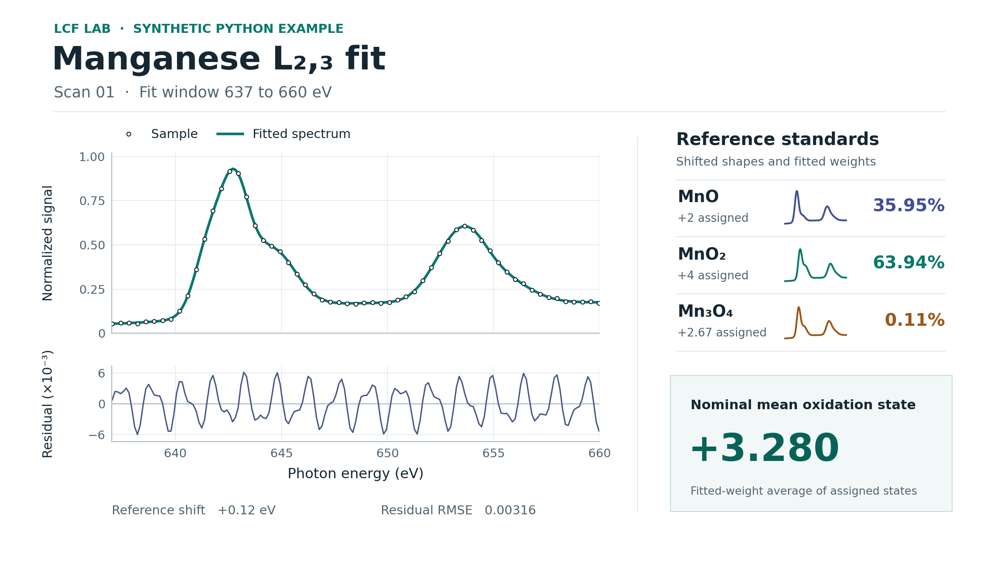

# Using the workbench

1. Select the element and analysis edge for the project.
2. Import already normalized sample spectra. Use **Reference library** to select a measured reference or **Add standard** to import your own. Supply energy in electronvolts and use comparable normalization for samples and standards. Plain CSV, TSV, and whitespace-delimited text are accepted. A sample CSV can contain one energy column followed by several sample columns.
3. Edit the reference labels and choose the standards to include. Nominal oxidation states and acquisition details are optional. A mixed-valence standard can use a fractional nominal value.
4. Select the fit interval, an optional bounded energy offset, and the coefficient constraint. Choose an interval inside the shared energy coverage.
5. Run the fit and select a sample in the batch table to inspect the overlay, residual, and reference weights. Review warnings before comparing results across scans.
6. Export the analysis and keep the ZIP to reproduce or review the run.

## Reference library

The starter library has 13 measured total electron yield (TEY) spectra for Mn, Co, Ni, and Cu. It filters by the analysis element and edge, then by the selected sample's detection mode when specified. Select **Show other or unspecified detection modes** to inspect the remaining references. CuO is a single comparison spectrum. Assess sample chemistry, energy calibration, normalization, and coverage before fitting. [Data sources and reproduction](../validation/reference-library.md)

Choose **Open a local reference pack** to browse a JSON pack on your computer. A version 1 pack contains `schema_version` set to 1, an `id`, `version`, `label`, and a list of `standards`. Each standard has a unique `id`, `label`, `element`, `edge`, increasing `energy` in eV, paired normalized `signal`, `provenance`, and `license`. Include `detection_mode`, `source_url`, and a description of processing when known. The `valence` field can be a nominal number or null. Use `mixed_nominal_valences` to describe a mixed-valence material without supplying a scalar.

Opened local packs are available until the workbench closes or reloads. The analysis ZIP contains the exact spectra and pack version used in a fit, including any local spectra. Follow the source data's redistribution terms when sharing an export.

## Fitting and interpretation

The fitter interpolates references on the sample's measured energy grid and evaluates trial offsets over the same data points. A positive offset moves reference features toward higher energy on the sample axis.

The sum-to-one option applies the constraint while solving the nonnegative fit. Use it for reference sets on compatible scales. Coefficients from a fit with a free sum depend on the scale of the supplied standards. The optional nominal mean describes the oxidation-state labels of the fitted reference mixture.

Reference similarity and missing components can leave contributions ambiguous. Review individual curves and the signed sample-minus-fit residual. Compare standards acquired in compatible detection modes, with comparable energy calibration and normalization.

## Synthetic Mn fit in Python

This example fits the first synthetic Mn L₂,₃-edge scan against three synthetic reference spectra. Run it with LCF Lab installed to print the fitted weights and the nominal mean Mn oxidation state.

```python
from lcf_lab import fit_batch
from lcf_lab.demo import demo_analysis

scan = fit_batch(demo_analysis("Mn"))["results"][0]
for reference in scan["weights"]:
    print(f"{reference['label']:<6} {reference['weight']:.2%}")
print(f"Nominal mean Mn oxidation state: {scan['nominal_valence']:+.3f}")
```



The nominal mean is calculated from the fitted reference weights and the oxidation-state labels supplied with the standards.

## Files in the export

| File | Contents |
|---|---|
| analysis.json | Input spectra, labels, provenance, and fit settings |
| results.json | Structured fit results, warnings, software version, and format version |
| summary.csv | One row per sample with fit status, nominal mean, offset, and residual error |
| reference_weights.csv | One row per fitted reference and sample |
| curves/ | Energy, observed signal, fitted signal, and residual for each successful sample |
